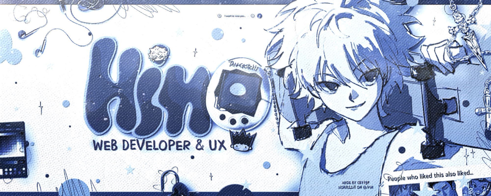

  
  

  

  <i>୨୧ ── 𓈒 𓏸 A little dream beneath the waves 𓏸 𓈒 ── ୨୧</i>

  
  
  
  
  

 

  

<h2 align="center">
  
 <i>About me</i> 

</h2>

  <i>𓈒 𓏸 Somewhere between dreams and code 𓏸 𓈒</i>

 

  Bonjour! ♡ I'm <b>Hinokame</b>, a Python and JavaScript
  developer who loves creating little worlds through code.
    
  I enjoy building bots, APIs and beautiful web experiences,
  always exploring new technologies and discovering new ways
  to bring my ideas to life.
    
  I'm a native Portuguese speaker, and I also speak English.
  My journey is filled with curiosity, creativity and
  a never-ending desire to learn.
    
  Just a little developer chasing big dreams,
  one line of code at a time. 🩵

 

  🩵 <i>Bot & API Developer</i>  
  🫧 <i>Passionate about technology and creativity</i>  
  🐚 <i>Music makes every coding session magical</i>  
  ✧ <i>Always learning, always blooming</i>  

 

  

<h2 align="center">
  🐚 <i>Technologies</i> 🐚
</h2>

  <i>୨୧ Tools I use to turn imagination into reality ୨୧</i>

  
  
  
  
  
  

  
  
  

 

  

<h2 align="center">
  ✧ <i>My little journey</i> ✧
</h2>

  <i>Every contribution is another drop in the ocean.</i>

  

 

  

  <i>“Even the smallest ripple can create a beautiful wave.”</i>
   
  𓈒 𓏸 Made with love, dreams & a touch of Hydro magic 𓏸 𓈒

